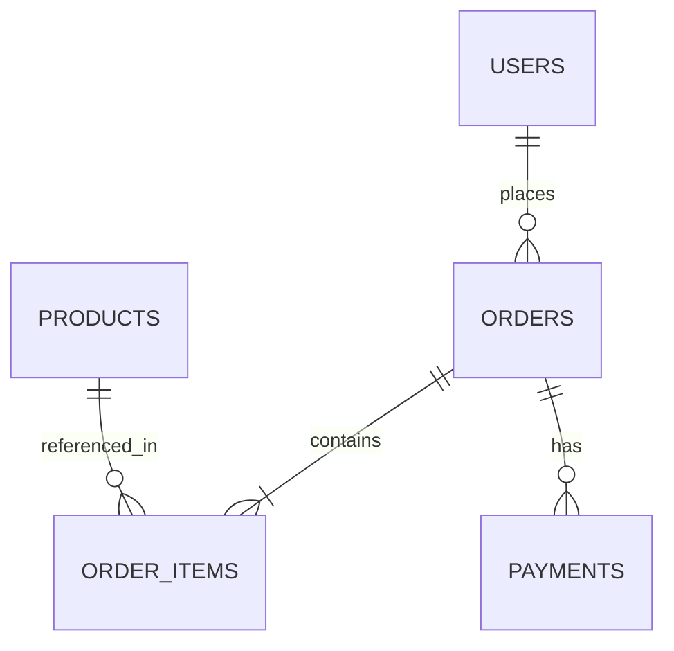

# Database

> **Назначение:** описание модели данных, ключевых таблиц, связей, индексов и принципов работы с БД.
> **Связано с:** [Architecture.md](./Architecture.md), [Glossary.md](./Glossary.md)
> **Обновлено:** YYYY-MM

---

## Общая информация

- **СУБД:** PostgreSQL 16 (или другая).
- **Имена:** `snake_case` для таблиц и колонок. Таблицы — во множественном числе (`orders`, `users`).
- **Первичные ключи:** UUID v4, колонка `id`.
- **Кодировка:** UTF-8.
- **Таймзона:** хранение в UTC, конвертация на уровне приложения.

---

## Принципы

### Soft delete
- Большинство сущностей имеют колонку `deleted_at TIMESTAMP NULL`.
- Hard delete — только для технических данных (логи, кеш, временные сущности).
- Все запросы должны учитывать `deleted_at IS NULL` (обычно через ORM scope).

### Аудит
Все ключевые таблицы содержат:
- `created_at TIMESTAMP NOT NULL DEFAULT NOW()`
- `updated_at TIMESTAMP NOT NULL DEFAULT NOW()` (обновляется триггером или ORM hook)
- `created_by UUID NULL` (если применимо)
- `updated_by UUID NULL` (если применимо)

### Денормализация
- По умолчанию — нормализуем (3NF).
- Денормализация — только под доказанные performance-требования, с комментарием в миграции.

---

## Основные таблицы

### `users`
Учётные записи в системе.

| Колонка | Тип | Описание |
|---------|-----|----------|
| `id` | UUID | PK |
| `email` | VARCHAR(255) | UNIQUE, NOT NULL |
| `password_hash` | VARCHAR(255) | bcrypt |
| `role` | VARCHAR(50) | `customer` / `operator` / `admin` |
| `status` | VARCHAR(50) | `active` / `blocked` / `pending` |
| `created_at` | TIMESTAMP | |
| `updated_at` | TIMESTAMP | |
| `deleted_at` | TIMESTAMP NULL | soft delete |

**Индексы:** `email`, `(status, created_at)`.

---

### `orders`
Заказы.

| Колонка | Тип | Описание |
|---------|-----|----------|
| `id` | UUID | PK |
| `customer_id` | UUID | FK → `users.id` |
| `status` | VARCHAR(50) | см. [Glossary: Заказ](./Glossary.md#заказ-order) |
| `total_amount` | NUMERIC(12,2) | NOT NULL |
| `currency` | CHAR(3) | ISO 4217 |
| `created_at` | TIMESTAMP | |
| `updated_at` | TIMESTAMP | |

**Индексы:** `customer_id`, `(status, created_at)`, `created_at`.

---

### `[Другие таблицы]`
[По тому же шаблону.]

---

## Связи

---

## Миграции

- **Инструмент:** [Prisma Migrate / TypeORM migrations / Flyway / Liquibase / golang-migrate].
- **Расположение:** `src/infrastructure/persistence/migrations/`.
- **Именование:** `YYYYMMDDHHMMSS_short_description.sql` (или согласно инструменту).
- **Принципы:**
  - Только forward-only миграции в продакшене.
  - Откат — отдельной миграцией, не `down`.
  - Никаких изменений данных и схемы в одной миграции (разделять).
  - Большие изменения схемы (>1M строк) — поэтапно, без блокировок (`CREATE INDEX CONCURRENTLY` и т.д.).

---

## Backup & Recovery

- Полный бэкап: ежедневно, хранение 30 дней.
- WAL-архивация: для PITR.
- Восстановление проверяется минимум **раз в квартал**.

---

## Производительность

### Что мониторим
- Долгие запросы (>500ms) — алерт в `#db-alerts`.
- Размер таблиц и индексов.
- Connection pool utilization.

### Правила
- Любой новый запрос с потенциалом >1000 строк — `EXPLAIN ANALYZE` обязательно.
- Запросы без индекса в hot path — блокер для PR.
- N+1 — антипаттерн, ловим на ревью и в integration-тестах.
