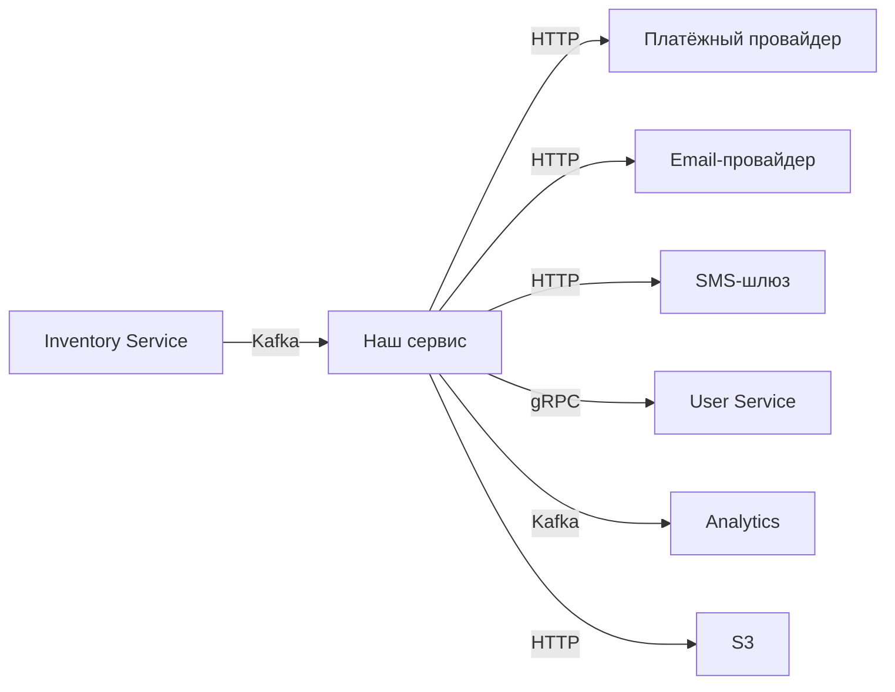

# Integrations

> **Назначение:** карта всех внешних сервисов и систем, с которыми взаимодействует наш сервис. Помогает быстро понять зависимости, blast radius при инцидентах и где искать креды/контракты.
> **Связано с:** [Architecture.md](./Architecture.md), [Deployment.md](./Deployment.md)
> **Обновлено:** YYYY-MM

---

## Как читать этот файл

- Каждая интеграция = отдельный раздел.
- Группировка по типу: **Внутренние сервисы** (наша инфра, другие команды), **Внешние провайдеры** (платёжки, нотификации, аналитика и т.д.), **Инфраструктурные**.
- Для каждой интеграции фиксируем: назначение, направление, протокол, URL'ы по окружениям, способ аутентификации, критичность, контакты.

---

## Карта зависимостей

---

## Уровни критичности

| Уровень | Что значит | Что происходит при отказе |
|---------|------------|----------------------------|
| 🔴 **Critical** | Без интеграции основной flow не работает | Сервис деградирует до minimum viable mode или падает |
| 🟡 **Important** | Критичен для части функций | Соответствующие функции возвращают ошибки, остальное работает |
| 🟢 **Optional** | Nice-to-have, можно жить без него | Логируем, продолжаем работать |

---

## Внутренние сервисы

### User Service
- **Назначение:** источник истины по пользователям (профили, роли, статусы).
- **Направление:** наш сервис → User Service (sync), User Service → наш сервис (events).
- **Протокол:** gRPC (запросы), Kafka (события).
- **Адреса:**
  - dev: `user-service.dev.internal:50051`
  - staging: `user-service.staging.internal:50051`
  - prod: `user-service.prod.internal:50051`
- **Аутентификация:** mTLS (сертификаты из Vault).
- **Контракты:** [protobuf](https://git.example.com/user-service/proto), Kafka-топик `users.events.v1`.
- **Критичность:** 🔴 Critical
- **Fallback при отказе:** локальный кеш профилей на 5 минут, новые регистрации блокируются.
- **Owner:** команда Users, Slack `#team-users`.

---

### Inventory Service
- **Назначение:** проверка наличия и резерв товаров.
- **Направление:** наш сервис → Inventory (sync для резервов), Inventory → наш сервис (события об изменении остатков).
- **Протокол:** HTTP REST + Kafka.
- **Адреса:**
  - dev: `https://inventory.dev.internal`
  - staging: `https://inventory.staging.internal`
  - prod: `https://inventory.prod.internal`
- **Аутентификация:** service-to-service JWT.
- **Контракты:** [OpenAPI](https://git.example.com/inventory/openapi.yaml), Kafka-топик `inventory.stock.v1`.
- **Критичность:** 🔴 Critical
- **Fallback при отказе:** оформление заказов недоступно, корзина продолжает работать.
- **Owner:** команда Catalog, Slack `#team-catalog`.

---

## Внешние провайдеры

### Платёжный провайдер ([Stripe / CloudPayments / YooKassa / ...])
- **Назначение:** приём платежей, выпуск чеков, возвраты.
- **Направление:** двунаправленно (наш сервис создаёт платежи, провайдер шлёт webhooks).
- **Протокол:** HTTPS REST + webhooks.
- **Адреса:**
  - prod: `https://api.payment-provider.com`
  - sandbox: `https://sandbox.payment-provider.com`
- **Аутентификация:** API key в заголовке `Authorization`. Webhook signature через HMAC-SHA256.
- **Креды:** Vault path `secret/integrations/payment-provider/{env}`.
- **Документация:** [официальная](https://docs.payment-provider.com)
- **Критичность:** 🔴 Critical
- **Rate limits:** 100 req/sec, 25 webhook ретраев с экспоненциальным backoff.
- **Fallback при отказе:** оформление заказов с предоплатой блокируется, заказы с оплатой при получении проходят.
- **Owner на нашей стороне:** [имя], аккаунт-менеджер у провайдера: [контакт].

---

### Email-провайдер ([SendGrid / Mailgun / Postmark / ...])
- **Назначение:** транзакционные письма (подтверждения, уведомления, восстановление пароля).
- **Направление:** наш сервис → провайдер.
- **Протокол:** HTTPS REST (или SMTP).
- **Адреса:**
  - все окружения: `https://api.email-provider.com`
  - sandbox-режим включается через флаг `EMAIL_SANDBOX_MODE=true` (для dev/staging).
- **Аутентификация:** API key.
- **Креды:** Vault path `secret/integrations/email/{env}`.
- **Документация:** [официальная](https://docs.email-provider.com)
- **Критичность:** 🟡 Important
- **Fallback при отказе:** письма копятся в очереди с TTL 24 часа, ретраи с backoff. Бизнес-flow не блокируется.
- **Owner:** [имя].

---

### SMS-шлюз ([Twilio / SMS.ru / ...])
- **Назначение:** OTP-коды для 2FA, критичные нотификации.
- **Направление:** наш сервис → шлюз.
- **Протокол:** HTTPS REST.
- **Адреса:**
  - все окружения: `https://api.sms-provider.com`
- **Аутентификация:** API key + sender ID.
- **Креды:** Vault path `secret/integrations/sms/{env}`.
- **Документация:** [официальная](https://docs.sms-provider.com)
- **Критичность:** 🟡 Important
- **Rate limits:** 10 SMS/sec.
- **Fallback при отказе:** для 2FA — fallback на email-код; для нотификаций — пропускаем с логом.
- **Owner:** [имя].

---

### Аналитика ([Amplitude / Mixpanel / ClickHouse / ...])
- **Назначение:** сбор продуктовых событий.
- **Направление:** наш сервис → аналитика (push).
- **Протокол:** HTTPS REST / батчинг.
- **Адреса:**
  - prod: `https://api.analytics-provider.com`
  - dev/staging: отдельный проект `https://api.analytics-provider.com` (другой токен).
- **Аутентификация:** API key.
- **Критичность:** 🟢 Optional
- **Fallback:** события буферизуются локально и дропаются при переполнении буфера. Бизнес-flow не страдает.

---

### Sentry (мониторинг ошибок)
- **Назначение:** сбор ошибок и performance-метрик.
- **Направление:** наш сервис → Sentry.
- **Протокол:** HTTPS.
- **Адреса:**
  - все окружения: `https://sentry.io` (или self-hosted `https://sentry.internal`).
- **Аутентификация:** DSN в `SENTRY_DSN`.
- **Критичность:** 🟢 Optional

---

## Инфраструктурные

### PostgreSQL
- **Назначение:** основное хранилище данных. Подробнее — [Database.md](./Database.md).
- **Адреса:** через `DATABASE_URL` (см. [Deployment.md](./Deployment.md)).
- **Критичность:** 🔴 Critical
- **Owner:** Platform team, `#team-platform`.

---

### Redis
- **Назначение:** кеш, rate-limiting, sessions, distributed locks.
- **Адреса:** через `REDIS_URL`.
- **Критичность:** 🟡 Important (без него работает медленнее, но работает).
- **Fallback:** in-memory fallback для критичных кешей, rate-limiting в degraded-режиме.

---

### Kafka
- **Назначение:** межсервисный обмен событиями.
- **Адреса:** через `KAFKA_BROKERS`.
- **Топики, которые мы пишем:**
  - `orders.events.v1` — события заказов (created, paid, cancelled, ...)
- **Топики, которые мы читаем:**
  - `users.events.v1` — события пользователей
  - `inventory.stock.v1` — изменения остатков
- **Критичность:** 🔴 Critical
- **Контракты:** Schema Registry, формат Avro/JSON Schema.

---

### Object Storage (S3 / MinIO)
- **Назначение:** хранение файлов (документы, чеки, экспорты).
- **Адреса:**
  - prod: `https://s3.region.amazonaws.com/bucket-name` (или endpoint облака).
  - dev/staging: MinIO `http://minio.internal:9000`.
- **Аутентификация:** AWS access keys из Vault.
- **Критичность:** 🟡 Important

---

## Чек-лист при добавлении новой интеграции

- [ ] Раздел в этом файле заполнен.
- [ ] Креды положены в Vault (никаких секретов в репозитории).
- [ ] Настроены ретраи и таймауты (default: 3 ретрая, timeout 5s).
- [ ] Настроен circuit breaker, если критичность 🔴 или 🟡.
- [ ] Добавлены метрики: `integration_requests_total`, `integration_request_duration_seconds`, `integration_errors_total` с label `integration`.
- [ ] Настроены алерты на error rate и latency.
- [ ] Определён fallback при отказе интеграции.
- [ ] Контракт зафиксирован (OpenAPI / protobuf / Avro schema).
- [ ] Указан owner на нашей стороне.

---

## Аварийные контакты

| Провайдер | Способ связи | SLA по реакции |
|-----------|--------------|-----------------|
| Платёжный провайдер | support@..., тикеты в личном кабинете | 1 час (prod incidents) |
| Email-провайдер | support@... | 4 часа |
| SMS-шлюз | support@... | 2 часа |
| [...] | [...] | [...] |
