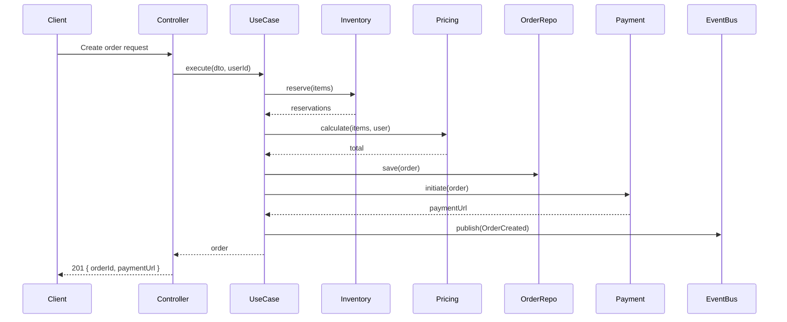

# Workflow: Создание заказа

> **Назначение:** описание полного процесса создания заказа от запроса клиента до подтверждения.
> **Триггер:** `POST /v1/orders`
> **Связано с:** [API.md](../API.md), [Database.md](../Database.md), [Glossary: Заказ](../Glossary.md#заказ-order)
> **Обновлено:** YYYY-MM

---

## Контекст

Клиент собирает корзину и отправляет её на оформление. Система должна:
- Проверить наличие товаров на складе.
- Зарезервировать товары.
- Рассчитать итоговую сумму с учётом скидок и доставки.
- Создать заказ в статусе `pending`.
- Запустить процесс оплаты.

---

## Участники

| Модуль | Слой | Ответственность |
|--------|------|------------------|
| `OrdersController` | Presentation | Приём HTTP, валидация DTO |
| `CreateOrderUseCase` | Application | Оркестрация процесса |
| `OrderFactory` | Domain | Создание сущности `Order` с валидацией бизнес-правил |
| `InventoryService` | Domain | Проверка и резервирование товаров |
| `PricingService` | Domain | Расчёт итоговой суммы |
| `OrderRepository` | Infrastructure | Сохранение в БД |
| `PaymentClient` | Infrastructure | Инициация платежа во внешнем провайдере |
| `EventBus` | Infrastructure | Публикация `OrderCreated` |

---

## Основной сценарий

1. **[Presentation]** `OrdersController.create()` принимает запрос, валидирует `CreateOrderDto`, извлекает `userId` из JWT.
2. **[Application]** `CreateOrderUseCase.execute(dto, userId)` — старт транзакции.
3. **[Domain]** `InventoryService.reserve(items)` — проверка наличия и резерв на 15 минут.
4. **[Domain]** `PricingService.calculate(items, user)` — расчёт суммы со скидками.
5. **[Domain]** `OrderFactory.create(...)` — создание сущности `Order` со статусом `pending`.
6. **[Infrastructure]** `OrderRepository.save(order)` — сохранение.
7. **[Infrastructure]** `PaymentClient.initiate(order)` — создание платёжной сессии.
8. **[Infrastructure]** `EventBus.publish(new OrderCreatedEvent(order))` — публикация события.
9. **[Application]** Коммит транзакции.
10. **[Presentation]** Возврат `201 Created` с `{ orderId, paymentUrl }`.

---

## Альтернативные сценарии

### Товара нет на складе
- `InventoryService` бросает `OutOfStockError`.
- Транзакция откатывается.
- Клиент получает `422` с кодом `ORDER_OUT_OF_STOCK` и списком недоступных позиций.

### Платёжный провайдер недоступен
- `PaymentClient` бросает `PaymentProviderUnavailableError`.
- Транзакция откатывается, резервы освобождаются.
- Клиент получает `503` с кодом `PAYMENT_PROVIDER_UNAVAILABLE`.
- Алерт в `#alerts-payments`.

### Пользователь заблокирован
- Проверка на старте use case → `403` с кодом `USER_BLOCKED`.

---

## Side effects

После публикации `OrderCreatedEvent`:
- **Notifications-сервис** отправляет email с подтверждением.
- **Analytics** пишет событие в data lake.
- **Inventory** запускает таймер автоматической отмены резерва через 15 минут, если оплата не пришла.

---

## Диаграмма

---

## Метрики и мониторинг

- `orders_created_total` — counter, label `status` (`success` / `failed`).
- `order_creation_duration_seconds` — histogram.
- Алерт: error rate > 5% за 5 минут → `#alerts-orders`.
